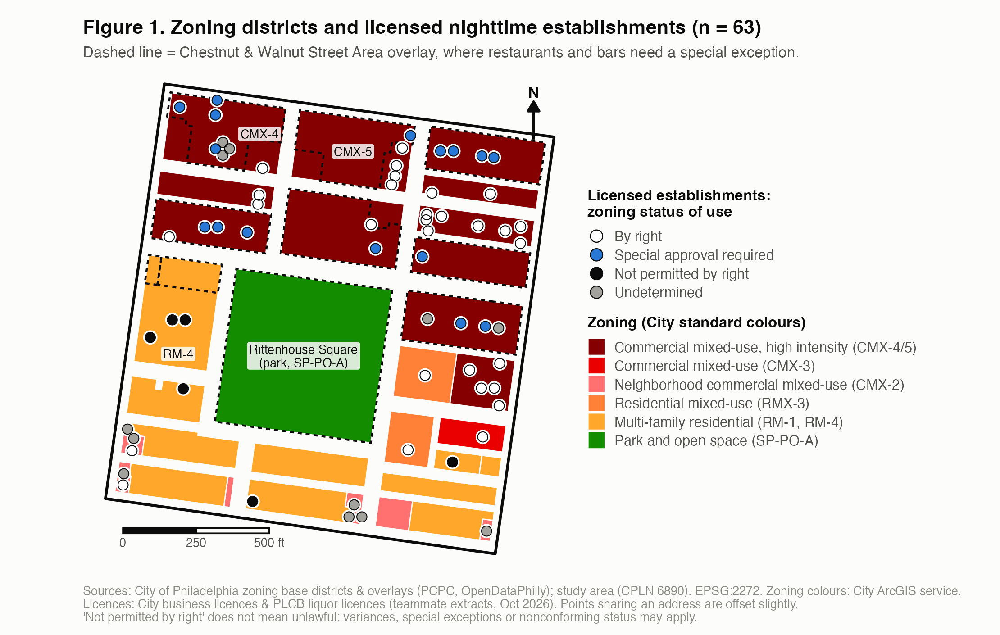
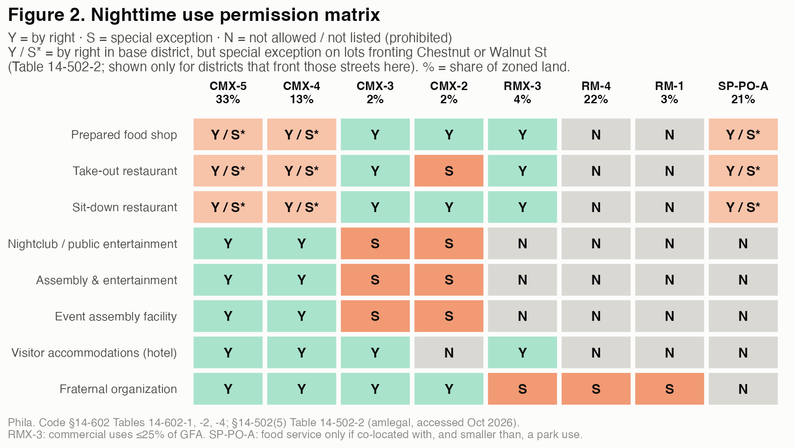

---
format:
  typst:
    papersize: us-letter
    margin: {x: 0.55in, y: 0.5in}
    fontsize: 9pt
    mainfont: "Helvetica Neue"
    keep-typ: true
---

```{=typst}
#set par(justify: false, leading: 0.55em)
#show heading: set block(above: 0.9em, below: 0.45em)
#show heading.where(level: 1): set text(size: 14pt)
#show heading.where(level: 2): set text(size: 10.5pt)
#set table(inset: (x: 4pt, y: 3pt))
#show table: set text(size: 8.5pt)
#show list: set block(spacing: 0.6em)
```

# Governance and Land Use: Nighttime Activities in Rittenhouse Square

*CPLN 6890 The City at Night · Governance & Land Use Brief, Phase 2 (final) · October 2026*

**Question.** Do licensed nighttime establishments in the study area operate in districts where their uses are permitted *by right*? "Not permitted by right" is **not** a finding of illegality: a use may be lawful through a special exception, a variance, or lawful nonconforming status.

## 1. Governance structure

| Governance | Jurisdiction |
|------------------------|------------------------------------------------------|
| City Council | Districts 5 (73%) and 2 (27%) |
| Police | 9th District |
| RCO | Center City Residents' Association (CCRA); Center City Organized for Responsible Development |
| BID / SSD | Center City District (69%) |
| Commercial corridor | Market West (Central) |

Council regulates zoning, Police handles enforcement, RCOs take part in zoning review, and the Center City District provides district services.

## 2. Zoning geography

{width=96%}

:::: {layout-ncol=2}
::: {}
- **Commercial mixed-use districts** cover **50%** of zoned land. The most intensive commercial zoning sits on the blocks north and east of the Square (Chestnut, Walnut, Sansom, 18th).
- **Residential districts** cover **29%**, mainly west of the Square and south of Spruce.
- **The park** (Rittenhouse Square) covers **21%**.
:::

::: {}
- **The Chestnut and Walnut Street overlay** adds a requirement on top of the base district. On lots fronting these streets, which make up 65% of commercially zoned land here, restaurants and bars need a special exception even where the base district allows them.
- Other overlays in the area contain no nighttime-use rules.
:::
::::



## 3. Nighttime use permission matrix

{width=66%}

:::: {layout-ncol=2}
::: {}
- **Restaurants** (prepared food shop, take-out, sit-down) are by right in every CMX district and RMX-3, except take-out in CMX-2 (special exception). However, they are prohibited in RM-1 and RM-4.
- **Nightclubs / public entertainment** (≥50 people gathering primarily for entertainment, §14-601(7)(c)(.2)) and other assembly uses are by right only in **CMX-4/5**, special exception in CMX-2/3, prohibited elsewhere.
:::

::: {}
- **"Bar" is not a zoning use.** Drinking places are Eating & Drinking Establishments unless they meet the nightclub definition; a liquor licence does not decide the zoning use.
- **Hotels** (Visitor Accommodations) are by right in CMX-3/4/5 and RMX-3, but not in CMX-2, RM-1 or RM-4.
:::
::::

## 4. Existing establishments vs. by-right zoning

**Data and method.** 124 current licence records (City business licences and PLCB liquor licences) correspond to **63 identifiable establishments**. Each establishment was placed in its zoning district and overlay, its likely zoning use was assigned from licence evidence, and that use was checked against the Code. Cases where the use or the lot could not be pinned down are marked undetermined.

::: {layout="[42,58]"}
| Classification | Establishments |
|---------------------------|---------------:|
| By right | 29 (46%) |
| Special approval required | 16 (25%) |
| Not permitted by right | 6 (10%) |
| Undetermined | 12 (19%) |
| **Total** | **63 (100%)** |

- **All 16 special-approval cases** are on the Chestnut and Walnut frontage: the overlay, not the base district, triggers the review.
- **All 6 not-by-right cases** are in multi-family residential districts, where restaurants and hotels are not allowed by right.
- City permit and Zoning Board records confirm an approval for **6 of these 22** establishments. For example, **Lucy's** (1720 Chestnut) received a special exception in 2023 for a restaurant with entertainment, on condition of no exterior music.
:::

**Not permitted by right ≠ illegal.** An establishment can operate lawfully through a special exception, a variance, or nonconforming status for a use that predates the 2012 Code. A licence does not show which applies; that needs an establishment-level check in Atlas.

## 5. Key takeaways

1. **Zoning separates commercial nightlife from residential areas.** Restaurants and entertainment uses are allowed by right in the commercial core north and east of the Square. The multi-family residential districts allow neither by right, and entertainment uses are barred from all residential districts and the park.
2. **The Chestnut/Walnut overlay adds another layer of regulatory review.** Along the two main streets, even the most intensive commercial zoning sends restaurants and bars to the Zoning Board for case-by-case approval.
3. **Business licensing and zoning authorization are distinct processes.** A current licence does not show zoning authorization: 22 licensed establishments run uses that need special approval or are not permitted by right, and only 6 of them have a confirmed approval in City records.

::: {.small}
*Sources:* Phila. Code Title 14, §§14-502, 14-529, 14-601, 14-602 (Tables 14-602-1/-2/-4), 14-502-2 (codelibrary.amlegal.com, accessed Oct 2026). OpenDataPhilly zoning base districts and overlays, council and police districts, RCOs, BIDs, commercial corridors. L&I business licences and PLCB licence extracts (teammate, Oct 2026). L&I zoning permits and ZBA appeals via phl.carto.com (the data behind atlas.phila.gov), retrieved 18 Oct 2026.
:::
